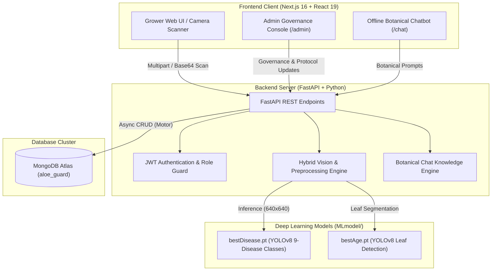

# AloeGuard (Project PAMADA 2.0)
### Aloe Vera Health Monitoring, Disease Pathology Detection, and Harvest Maturity System

[](https://nextjs.org/)
[](https://fastapi.tiangolo.com/)
[](https://github.com/ultralytics/ultralytics)
[](https://pytorch.org/)
[-47A248?style=flat-square&logo=mongodb)](https://www.mongodb.com/)
[](https://www.typescriptlang.org/)
[](https://www.python.org/)

**AloeGuard** is an end-to-end precision agriculture and computer vision system engineered specifically for *Aloe barbadensis Miller* cultivation. Originating from the academic capstone research paper (*BUONG PAPEL*) and advancing the earlier PAMADA initiative, the system unifies Deep Learning foliar pathology diagnosis, rosette leaf segmentation for maturity & age estimation, IoT soil telemetry, and governance.

---

## Key System Features

### 1. Failsafe Species Verification Gate
- Automated colorimetric and foliar spectrum validation rejects non-Aloe or corrupted images prior to neural network inference.
- Prevents false-positive classifications on unrelated plants and background noise (returns HTTP 422 with descriptive agronomic feedback).

### 2. Deep Learning Foliar Pathology Classification (`bestDisease.pt`)
- **Architecture:** Ultralytics YOLOv8 Object Detection & Classification.
- **Disease Profiles Supported (9 Categories):**
  - **Leaf Spot** (*Cercospora / Alternaria*)
  - **Sunburn** (*Acute solar UV scorching*)
  - **Root Rot** (*Phytophthora nicotianae*)
  - **Bacterial Soft Rot** (*Pectobacterium chrysanthemi*)
  - **Anthracnose** (*Colletotrichum gloeosporioides*)
  - **Aloe Rust** (*Uromyces aloes*)
  - **Mealy Bugs** (*Pseudococcidae*)
  - **Scale Insects** (*Diaspididae*)
  - **Spider Mites** (*Tetranychidae*)
  - **Healthy Specimen** (*Foliar tissue optimal*)
- Provides localization bounding boxes, confidence percentages, severity indicators, and curative protocols.

### 3. Harvest Maturity & Age Estimation Pipeline (`bestAge.pt`)
- **Rosette Leaf Detection:** Uses a dedicated YOLOv8 model trained to identify and segment individual succulent leaves (`{0: 'leaf'}`).
- **Morphometric Phenology Matrix:**
  - **`< 1 Year (Juvenile)`**: Fewer than 8 leaves, blade thickness < 10 mm. *Harvesting restricted to protect vegetative growth.*
  - **`1 – 2 Years (Developing)`**: 8–11 leaves, blade thickness 10–13 mm. *Active growth stage, gel synthesizing.*
  - **`2 – 3 Years (Mature / Harvest-Ready)`**: 12–15 leaves, blade thickness 13–15 mm. *Outer basal leaves ready for selective cutting.*
  - **`3 – 4+ Years (Prime Commercial)`**: 16+ leaves, blade thickness > 15 mm. *Peak acemannan polysaccharide concentration.*

### 4. Offline Botanical Chatbot (`/chat`)
- Embedded agronomic advisory engine for off-grid farm operations.
- Answers questions regarding soil NPK requirements, irrigation intervals, pathogen treatment, and harvesting guidelines without external internet connection.

### 5. Strict Role Separation (Grower vs. Admin Governance)
- **Grower Workspace (`/dashboard`, `/detect`, `/maturity`, `/sensors`, `/plants`)**:
  - Live AI plant scanning via webcam or image upload.
  - Interactive maturity tracking, soil NPK telemetry, harvest grading, and diagnostic scan archive.
- **Administration Console (`/admin`)**:
  - Dedicated system governance dashboard (No user scanning or plant upload interfaces).
  - 9 Modular Management Tabs: User Administration, Plant Records Audit, Scan Auditing, Dynamic Disease Library & Protocol Editor, Recommendations Management, AI Model Telemetry, Reports & Analytics, Activity Logs, and System Settings.

---

## System Architecture



---

## Project Structure

```
├── backend/
│   ├── app/
│   │   ├── core/
│   │   │   ├── config.py         # Application settings & environment vars
│   │   │   ├── database.py       # Motor async MongoDB client & collections
│   │   │   ├── security.py       # Password hashing & JWT token verification
│   │   │   └── vision.py         # Vision pipeline (YOLOv8 + species gate + age)
│   │   ├── routers/
│   │   │   ├── admin.py          # Admin governance endpoints & protocol editing
│   │   │   ├── auth.py           # Register, login, profile, and role checks
│   │   │   ├── chat.py           # Offline botanical chatbot router
│   │   │   ├── vision.py         # /vision/analyze and unified scan persistence
│   │   │   ├── plants.py         # Specimen record management
│   │   │   ├── maturity.py       # Phenology & maturity assessments
│   │   │   ├── sensors.py        # IoT NPK / moisture telemetry
│   │   │   └── reports.py        # Farm profit & quality grading
│   │   └── main.py               # FastAPI application entrypoint & CORS config
│   ├── MLmodel/
│   │   ├── bestDisease.pt        # Trained YOLOv8 weights for 9 Aloe diseases
│   │   └── bestAge.pt            # Trained YOLOv8 weights for Aloe leaf detection
│   └── tests/                    # 23 automated Pytest test suites
├── frontend/
│   ├── src/
│   │   ├── app/
│   │   │   ├── admin/page.tsx    # 9-Tab Administration Console
│   │   │   ├── chat/page.tsx     # Offline Botanical AI Chatbot interface
│   │   │   ├── dashboard/page.tsx# Grower operational dashboard
│   │   │   ├── detect/page.tsx   # Live Aloe Vera camera & file scanner
│   │   │   ├── maturity/page.tsx # Phenology & harvest maturity tracking
│   │   │   ├── results/page.tsx  # Diagnostic report & age analysis view
│   │   │   └── ...               # Additional farm management views
│   │   ├── components/
│   │   │   ├── aloe-guard.tsx    # Role-aware sidebar, navigation, and frame
│   │   │   └── plant-scanner.tsx # Dual camera/upload AI intake component
│   │   └── lib/
│   │       ├── api.ts            # Type-safe API client & interfaces
│   │       └── auth-context.tsx  # Client-side session and auth state
│   ├── package.json
│   └── next.config.ts
├── documentations/               # Comprehensive project and capstone docs
│   ├── system_plan.md            # Master architectural specification
│   ├── BACKEND_STRUCTURE.md      # Backend schema & design patterns
│   ├── FRONTEND_STRUCTURE.md     # Component layout & route structure
│   └── BUONG PAPEL.docx          # Full Capstone Research Documentation
├── run-tests.ps1                 # Full-stack backend + frontend test runner
├── start-dev.ps1                 # Automated parallel service launcher
└── README.md
```

---

## Quickstart & Installation

### Prerequisites
- **Node.js** 18.x or 20.x+
- **Python** 3.10 to 3.14
- **MongoDB Atlas** connection string or local MongoDB instance

---

### Step 1: Clone the Repository
```bash
git clone https://github.com/VinByte365/Project-Pamada-2.0.git
cd Project-Pamada-2.0
```

---

### Step 2: Configure Environment Variables

Create a root `.env` file (or configure in `backend/`):
```env
MONGODB_URL=mongodb+srv://<username>:<password>@cluster.mongodb.net/aloe_guard?retryWrites=true&w=majority
DATABASE_NAME=aloe_guard
SECRET_KEY=your_secure_jwt_secret_key_here
PORT=8000
FRONTEND_URL=http://localhost:3000
```

In `frontend/.env.local`:
```env
NEXT_PUBLIC_API_URL=http://127.0.0.1:8000
```

---

### Step 3: Install Dependencies

#### Backend
```bash
cd backend
python -m pip install -r requirements.txt
# Ensure Ultralytics and PyTorch are installed for ML models
pip install torch ultralytics pillow
cd ..
```

#### Frontend
```bash
cd frontend
npm install
cd ..
```

---

### Step 4: Run the Application

#### Option A: One-Click PowerShell Launcher (Windows)
```powershell
.\start-dev.ps1
```
This automatically opens two dedicated terminals launching both the FastAPI backend and Next.js frontend.

#### Option B: Manual Execution

**Terminal 1 (Backend):**
```bash
cd backend
python -m uvicorn app.main:app --reload --port 8000
```
- API is running at: `http://127.0.0.1:8000`
- Interactive Swagger documentation: `http://127.0.0.1:8000/docs`
- Health probe: `http://127.0.0.1:8000/health`

**Terminal 2 (Frontend):**
```bash
cd frontend
npm run dev
```
- Web Application is accessible at: `http://localhost:3000`

---

## Default Access & Roles

| Role | Access URL | Capabilities |
| :--- | :--- | :--- |
| **Grower / Farmer** | `http://localhost:3000/dashboard` | AI Folia Scanner, Disease Detection, Maturity & Age Tracking, Soil NPK Monitoring, Chatbot. |
| **Administrator** | `http://localhost:3000/admin` | User Governance, Scan Auditing, Plant Inventory Management, Dynamic Clinical Disease Protocol Editing, AI Telemetry. |

*Note: Administrator accounts logging into the application are automatically redirected to `/admin` to ensure strict separation of concerns.*

---

## Running Automated Tests

To execute the full verification test suite across both backend and frontend:

```powershell
.\run-tests.ps1
```

Or run each suite individually:

```bash
# 1. Backend Pytest Suite (23 test cases)
python -m pytest backend/tests

# 2. Frontend Production Build & Typecheck (31 routes)
npm --prefix frontend run build
```

---

## Academic Basis & Capstone Team

- **Academic Paper:** *BUONG PAPEL* (Aloe Vera Plant Health Monitoring and Harvest Maturity Detection System)
- **Primary Domain:** Precision Agriculture, Computer Vision, Succulent Phytopathology, Embedded IoT Monitoring
- **Institution:** Capstone Research Team (Project PAMADA 2.0)
- **Repository:** [https://github.com/VinByte365/Project-Pamada-2.0](https://github.com/VinByte365/Project-Pamada-2.0)

